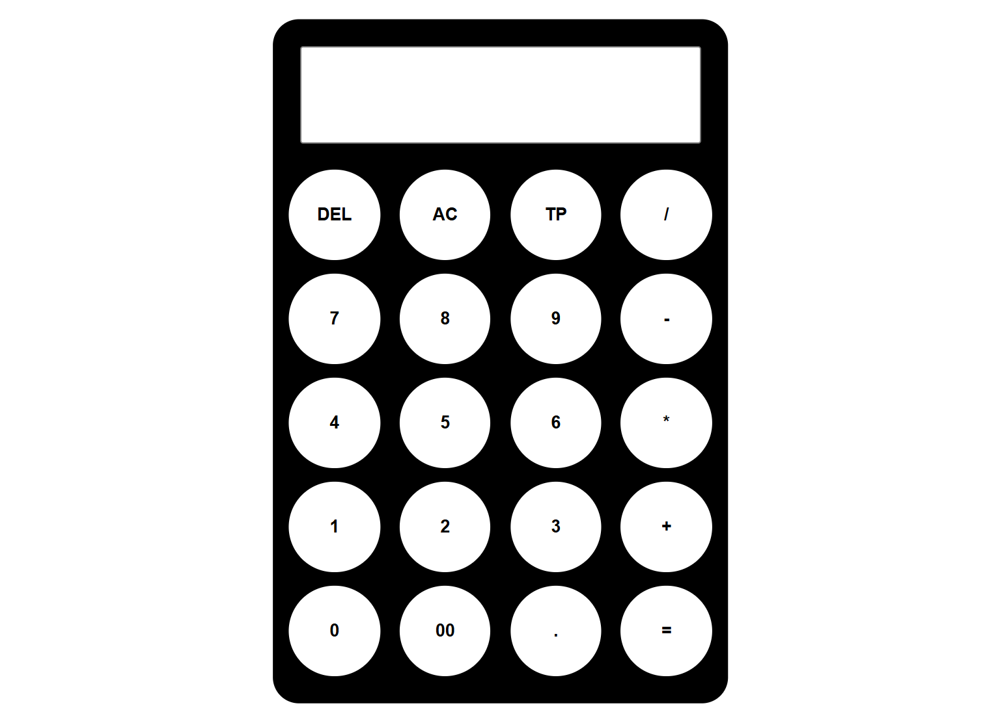

# Calculator

A simple, modern, and responsive calculator built using HTML, CSS, and JavaScript. This project performs basic arithmetic operations with a clean user interface that works across different screen sizes and devices.

## Features

- Basic Arithmetic Operations: Addition, subtraction, multiplication, and division.
- Responsive Design: Works smoothly on desktops, tablets, and mobile devices.
- User-Friendly Interface: Simple and clean calculator layout.
- Clear Function: Easily clear the current input.
- Delete Function: Remove the last entered digit.
- Real-Time Calculations: Instantly displays user input and results.
- Interactive Buttons: Smooth button interactions using CSS.
  
## Technologies Used

- HTML5 : Structure of the calculator.
- CSS3 : Styling, layout, and responsive design.
- JavaScript : Calculator functionality and user interactions.
 
## Project Structure

Calculator/
│
├── index.html
├── style.css
├── script.js
├── README.md
└── screenshot/
    └── calculator.png
    
## Preview - screenshot

## Project Objective

The main objective of this project is to strengthen front-end development skills by building an interactive calculator while learning HTML structure, CSS styling, responsive web design, and JavaScript DOM manipulation.

## Future Improvements

- Add scientific calculator functions.
- Implement keyboard support.
- Add calculation history.
- Introduce light and dark themes.

## Author

Shireesha

Github: github.com/SireeC
